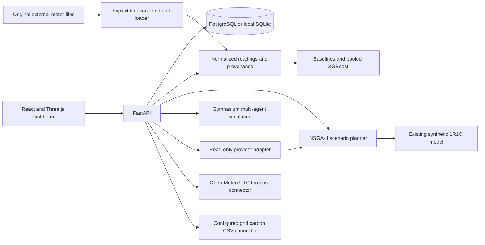

# MLRIT Sustainable Campus Twin

This is a separate application layer alongside the original `building_hvac_twin` package. The original 1R1C thermal model is preserved and remains a synthetic reference. Campus resource forecasts use their own meter-data pipeline.

## Local development

Create an isolated environment and install the application and research extras:

```powershell
python -m venv .venv
.\.venv\Scripts\python -m pip install -e ".[dev,campus,ml,planning]"
.\.venv\Scripts\uvicorn campus_twin.main:app --reload
```

In a second terminal, install the web dependencies and start the frontend:

```powershell
cd frontend
pnpm install
pnpm dev
```

The frontend runs at `http://localhost:5173`; the API and interactive API docs run at `http://localhost:8000` and `http://localhost:8000/docs`. For the PostgreSQL path use `docker compose up --build`. The local SQLite fallback creates `campus_twin.db`, which is ignored by Git.

## Evidence and provenance

The seeded meter readings are deterministic synthetic examples, not MLRIT utility records. The 3D boxes and relative positions are schematic and are not surveyed geometry. Floor counts are intentionally unknown. Public source documents disagree on building counts and naming; the application records that limitation rather than claiming a verified floor plan.

The seeded area values are reported in the 2023 MLRIT NAAC self study. Visual and layout references are linked from the UI:

- [MLRIT official virtual campus tour](https://mlrit.ac.in/student-life/discover-mlr)
- [MLRIT site plan / equipment layout](https://naac.mlrit.ac.in/assets/dvv/metrics/7.1.2/1.pdf)
- [MLRIT institutional self study report](https://naac.mlrit.ac.in/assets/2ndcyclessr.pdf)

## Architecture



Raw dataset files belong under `data/raw/` and must remain unchanged. The ASHRAE loader requires explicit site timezone and meter-unit mappings. It rejects ambiguous daylight-saving timestamps and missing unit mappings rather than inferring them. The external dataset is not included in this repository.

## API

- `GET /api/v1/buildings`, `/sources`, `/readings`
- `POST /api/v1/readings` for explicitly unit-tagged, timezone-aware interval readings
- `GET /api/v1/buildings/{id}/summary`, `/forecasts`, and `/anomalies`
- `POST /api/v1/weather/open-meteo` with required coordinates and IANA timezone
- `POST /api/v1/scenarios/optimize` with required tariff, carbon, comfort, budget, setpoint, and equipment limits
- `POST /api/v1/chat` with a read-only tool allowlist

Forecast output is marked `predicted`; NSGA-II outputs are marked `simulated`. Residual anomaly flags are candidates for review, not fault diagnoses. The chat demo has deterministic responses and no credentials. Amazon Bedrock can be enabled with `CAMPUS_ASSISTANT_PROVIDER=bedrock`, `BEDROCK_MODEL_ID`, `AWS_REGION`, and the AWS SDK credential chain; its tools cannot issue equipment commands.

## ASHRAE experiment

The labeled `train.csv`, `building_metadata.csv`, and `weather_train.csv` files are expected in an external data directory. Build a JSON config containing `site_timezones`, `meter_units`, `train_end`, `calibration_end`, `test_start`, and `heldout_building_ids`. Use only meter types with available labeled data. Future-time and unseen-building evaluations are separate; results are grouped by meter type. The public Kaggle competition test labels are not used.

The experiment reports MAE, RMSE, CVRMSE, NMBE, and empirical interval coverage/width. A model score is not promised to beat a simple baseline. Do not compare the 1R1C thermal outputs with meter-level ASHRAE forecasts.

## NSGA-II and RL

`pymoo` setpoint search uses the 1R1C simulation and explicit scenario inputs. It is synthetic-only, cannot control equipment, and marks infeasible candidates. The Gymnasium/RLlib environment defines one coordinator and a building agent per simulated building. Rule-based and independent-agent baselines are provided. Training with Ray on Windows is beta; for more repeatable multi-agent runs, use Linux or Docker. Do not interpret RL policies as operational recommendations without measured validation.

## Tests

Run `pytest -q` and `python tests/smoke_test.py`. Tests use temporary SQLite storage and synthetic fixtures; they do not validate MLRIT campus energy performance. The original HVAC tests remain in `tests/`.

## Verification record

Before campus changes, the original suite passed with 9 tests and the smoke test printed `SMOKE PASS 32.177 kWh synthetic`. The smoke workflow rewrites runtime metadata in its reference summary, so that tracked baseline artifact is preserved at its original contents.

The campus changes add API, schema, forecasting, connector, scenario, and agent-safety checks. Verification completed with `.venv/Scripts/pytest.exe -q --basetemp=.venv/tmp/pytest` reporting `24 passed, 15 warnings`; `.venv/Scripts/python.exe tests/smoke_test.py` printed `SMOKE PASS 32.177 kWh synthetic`. The warnings are existing pandas day-of-week deprecations in the original HVAC package and its tests. `frontend/node_modules/.bin/tsc.cmd -b` passed, and `frontend/node_modules/.bin/vite.cmd build` passed. Vite reports the deferred Plotly chunk at about 4.8 MB minified. `docker compose config --quiet` passed.

No ASHRAE dataset was supplied with the workspace, so no campus meter forecast score is reported. No campus meter records were supplied, and no MLRIT performance claim is made. The Docker CLI is installed, but its daemon is not running, so the integrated containers were not started. Ray RLlib training and live Open-Meteo fetches were not run in this environment; connector normalization, agent environment logic, rule-based baselines, scenario constraints, and deterministic API paths have local tests.
